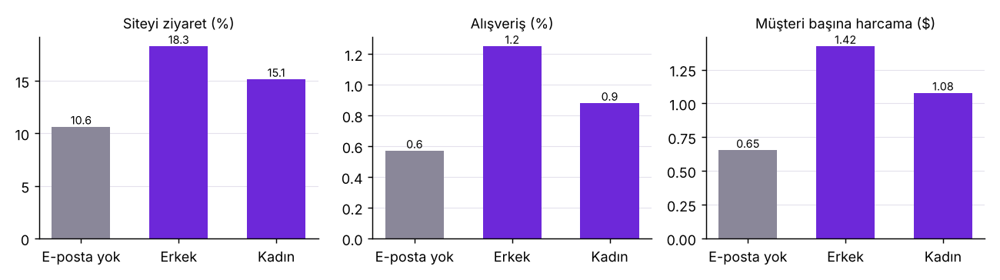
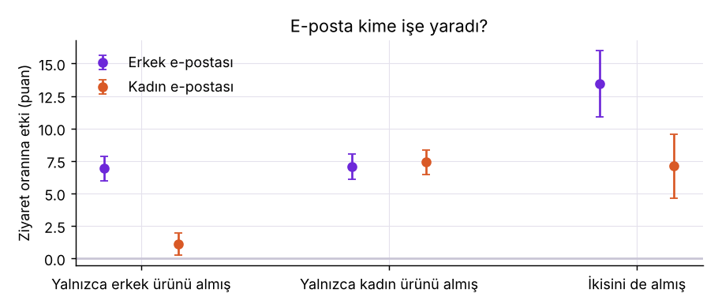
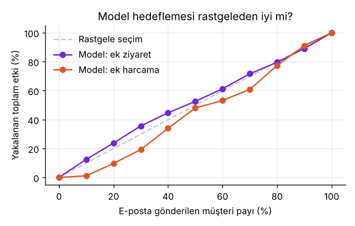

# E-posta Kampanyası Gerçekten Satış Getirdi mi?

64.000 müşterinin rastgele üç gruba ayrıldığı bir e-posta kampanyası deneyinin analizi: erkek ürünleri
e-postası, kadın ürünleri e-postası, e-posta yok. Sonuçlar e-postadan sonraki iki haftayı kapsıyor.

**Rapor:** https://ozgurnurettinozturk.com/kampanya-etki-analizi

## Sonuçlar

| Etki (e-posta yok grubuna göre) | Erkek e-postası | Kadın e-postası |
|---|---|---|
| Ziyaret oranı | +7,66 puan (+%72) | +4,52 puan (+%43) |
| Alışveriş oranı | +0,68 puan (+%119) | +0,31 puan (+%54) |
| Müşteri başına harcama | +$0,77 ($0,49 – $1,05) | +$0,42 ($0,17 – $0,68) |

- **Harcamanın hepsi e-postanın değil.** Erkek e-postası alanların harcamasının %54'ü e-postadan geliyor;
  gerisi e-posta olmadan da olacaktı. Kontrol grubu olmayan bir rapor etkiyi 1,8 kat büyük gösterirdi.
- **Etki daha fazla alıcıdan geliyor, daha büyük sepetten değil.**
- **Kadın e-postası yalnızca erkek ürünü almış müşterilerde neredeyse işe yaramadı** (ziyaret +1,1 puan,
  kadın ürünü alanlarda +7,4); erkek e-postası iki grupta da aynı ölçüde işe yaradı.
- **Hedefleme modeli kazandırmadı.** Üç kollu T-learner, "herkese erkek e-postası" kuralını geçemedi; etki
  müşteriden müşteriye pek değişmiyor.





## Çalıştırma

```bash
pip install -r requirements.txt
python -c "from sklift.datasets import fetch_hillstrom; d=fetch_hillstrom(target_col='all', return_X_y_t=False); import pandas as pd; import os; os.makedirs('data', exist_ok=True); pd.concat([d.data, d.target, d.treatment], axis=1).to_csv('data/hillstrom.csv', index=False)"
python analiz.py          # outputs/summary.json ve grafikler
```

## Yöntem

- Deney denetimi: grup büyüklükleri (ki-kare) ve özelliklerde standartlaştırılmış fark.
- Ortalama etki: grup ortalamaları farkı, %95 aralık.
- Alt gruplar: önceden seçilmiş değişkenler; çoklu karşılaştırma nedeniyle ipucu olarak okunmalı.
- Hedefleme: her grup için ayrı gradyan artırma modeli (T-learner), 5 katlı çapraz uydurma; politikaların
  değeri, önerilen e-postayı tesadüfen almış müşterilerin ortalamasıyla ölçüldü.
- Kâr: maliyet ve marj veride yok; başabaş e-posta maliyeti farklı marj varsayımlarıyla hesaplandı.

## Sınırlar

2008, tek bir ABD perakendecisi; iki haftalık pencere; yalnızca 578 alışveriş; maliyet verisi yok.

Veri: Kevin Hillstrom, MineThatData E-Mail Analytics and Data Mining Challenge (2008).
